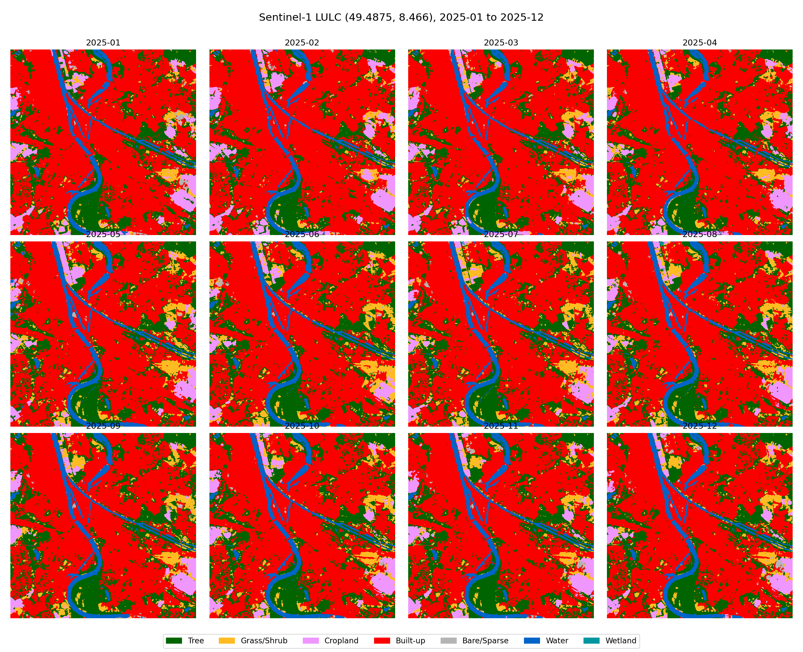
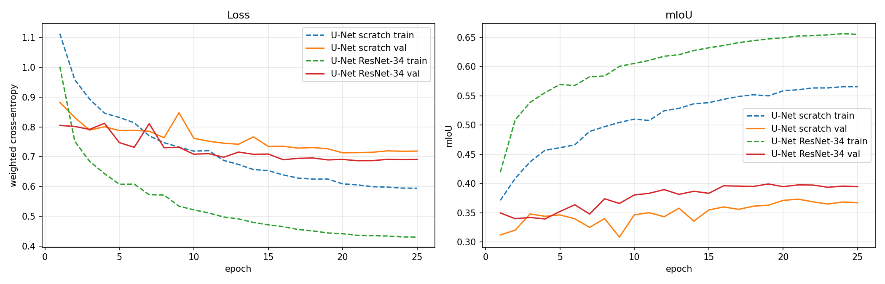
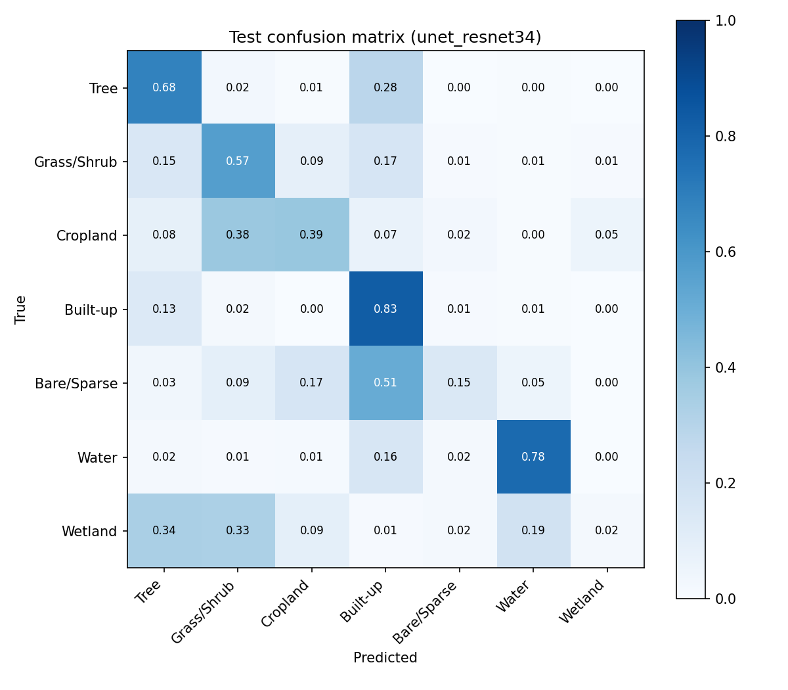
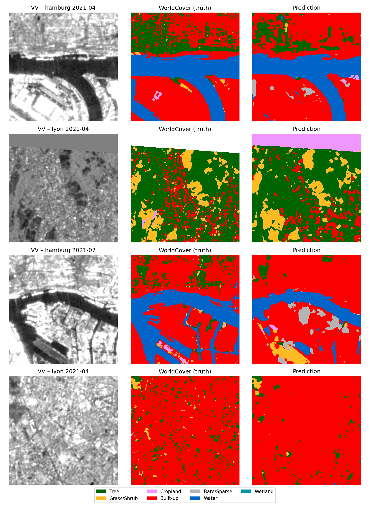
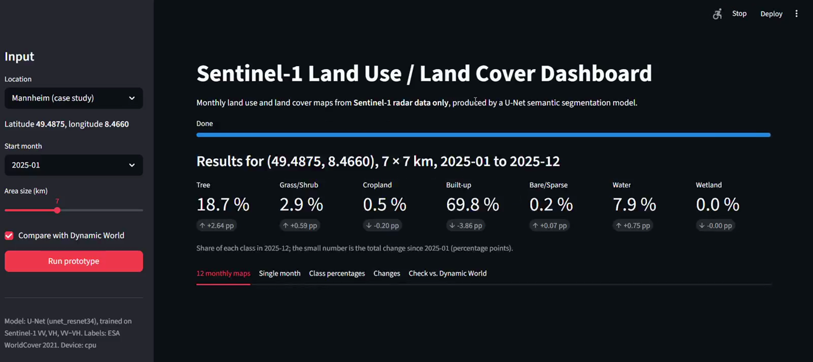
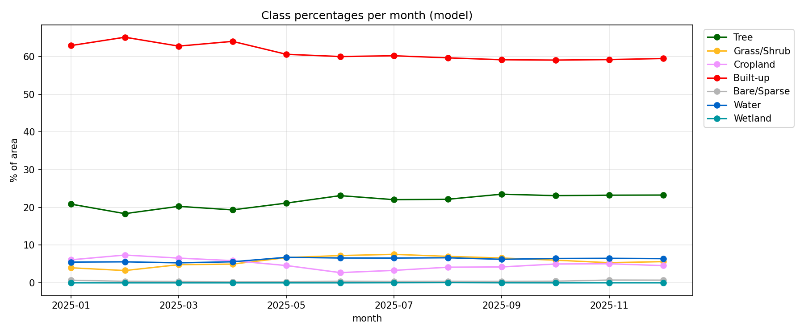

# Monthly Land Use / Land Cover Mapping from Sentinel-1 SAR with U-Net

Semantic segmentation of land use and land cover (LULC) using **only Sentinel-1 radar data**, plus a prototype and an interactive dashboard that produce **12 monthly LULC maps for any location** and calculate how the land cover changes over the year.

   

<p align="center">
  
</p>

> Course project – *Data Analytics 3: Predictive Analytics and Deep Learning*, M.Sc. Applied Data Science and Analytics, SRH University (2026).
> Full report: [`docs/LULC_Report.pdf`](docs/LULC_Report.pdf)

---

## Contents
- [Why Sentinel-1?](#why-sentinel-1)
- [Results](#results)
- [Pipeline](#pipeline)
- [Dataset](#dataset)
- [Model](#model)
- [Prototype and dashboard](#prototype-and-dashboard)
- [Case study: Mannheim](#case-study-mannheim)
- [Repository structure](#repository-structure)
- [How to run](#how-to-run)
- [Limitations](#limitations)
- [References](#references)

---

## Why Sentinel-1?

Most land cover maps are made from optical satellites (e.g. Sentinel-2), which cannot see through clouds. In Central Europe, many months have no usable optical image. **Sentinel-1 is a radar (SAR) satellite**: it sends its own microwave signal, works through clouds and at night, and therefore delivers data for **every month**. The challenge is that radar images are noisy (speckle) and some land-cover types look very similar.

---

## Results

Evaluation on **Lyon and Hamburg**, two regions that were **never seen during training** (spatial split).

| Model | Parameters | Val mIoU (Munich) | Test OA | Test mIoU |
|---|---|---|---|---|
| U-Net from scratch | 7.8 M | 0.373 | 74.2 % | 0.368 |
| **U-Net + ResNet-34 (ImageNet-pretrained)** – final | 24.4 M | **0.399** | 73.7 % | **0.373** |

Per-class results of the final model:

| Class | IoU | F1 |
|---|---|---|
| Water | 0.721 | 0.838 |
| Built-up | 0.633 | 0.775 |
| Tree | 0.571 | 0.727 |
| Grass/Shrub | 0.451 | 0.622 |
| Cropland | 0.201 | 0.335 |
| Bare/Sparse | 0.031 | 0.061 |
| Wetland | 0.005 | 0.010 |

Water, built-up and trees have a clear radar signature and are recognized well. Cropland, bare land and wetland are rare in the test regions and are often confused with grass/shrub or built-up. Results per season (OA 73.4–74.4 %) show only a small seasonal effect.

<p align="center">
  
</p>
<p align="center">
  
  
</p>

---

## Pipeline

```
Google Earth Engine                      PyTorch (Colab, T4 GPU)              Prototype / Dashboard
────────────────────                     ───────────────────────              ─────────────────────
Sentinel-1 GRD (VV, VH)                  normalisation (train stats)          lat/lon + start month
 → border-noise mask (< −30 dB)          256×256 patches + augmentation        → 12 monthly composites
 → 3×3 median speckle filter      ───►   U-Net (scratch vs. ResNet-34)  ───►   → U-Net prediction
 → monthly median composite              weighted cross-entropy, AdamW         → % per class
 → + VV−VH band                          model selection on validation         → month-to-month & total change (pp)
ESA WorldCover 2021 labels (7 classes)   OA, mIoU, IoU/F1, confusion matrix    → check vs. Dynamic World
```

---

## Dataset

Built in Google Earth Engine ([`notebooks/01_data_export_gee.ipynb`](notebooks/01_data_export_gee.ipynb)).

| | |
|---|---|
| **Input** | Sentinel-1 GRD, IW mode, VV + VH (dB) + VV−VH, monthly median composites, 10 m |
| **Labels** | ESA WorldCover 2021 (10 m), 11 classes merged into 7 |
| **Regions** | 10 European regions, 16 × 16 km each |
| **Months** | January, April, July, October 2021 (one per season) |
| **Size** | 40 GeoTIFFs (10 regions × 4 months), ~1.5 GB |
| **Split (by region)** | Train: Paris, Lelystad, Black Forest, Po Valley, Madrid, Danube Delta, Warsaw · Validation: Munich · Test: Lyon, Hamburg |
| **Patches** | 3,928 train · 144 validation · 288 test (256 × 256 px) |

**Classes:** Tree · Grass/Shrub · Cropland · Built-up · Bare/Sparse · Water · Wetland

**Download:** [Google Drive – dataset](https://drive.google.com/drive/folders/1KMKVzDfUEWPHXW6wCaoX5P6uBJ7CjUGc), or recreate it with Notebook 1.

The split is done by **region**, not by random patches: neighbouring patches are almost identical, so a random split would give a too optimistic test score.

---

## Model

**U-Net** – encoder (learns *what* is in the image), decoder (decides *where*), and skip connections (keep fine details such as field borders and roads).

| Setting | Value |
|---|---|
| Input | 3 bands (VV, VH, VV−VH), 256 × 256 |
| Output | 7 classes per pixel |
| Loss | Cross-entropy with class weights 1/√frequency |
| Optimiser | AdamW, cosine learning-rate schedule, 25 epochs, batch size 16 |
| Learning rate | 1e-3 (scratch), 3e-4 (pretrained) |
| Model selection | Best validation mIoU (Munich) |

**Weights:** `model_best.pt` (98 MB, too large for GitHub) → [Google Drive – model weights](https://drive.google.com/drive/folders/1WnvoHCqf3sy7Yjw6OGgMt3wI-Yv-5_rn). The configuration (classes, colours, normalisation values) is in [`prototype/model_config.json`](prototype/model_config.json).

---

## Prototype and dashboard

**Input:** latitude, longitude, start month · **Output:** 12 monthly LULC maps, % of area per class, month-to-month change and total change in **percentage points**, and an independent check against Google Dynamic World (Sentinel-2 based, not used for training).

Three ways to use it:
- **Command line** – [`prototype/lulc_prototype.py`](prototype/lulc_prototype.py)
- **Notebook** – [`prototype/prototype_demo.ipynb`](prototype/prototype_demo.ipynb) (with outputs of the Mannheim run)
- **Interactive dashboard** – [`prototype/dashboard.py`](prototype/dashboard.py) (Streamlit)

<p align="center">
  
</p>

Demo video: [`docs/demo_dashboard_mannheim.mp4`](docs/demo_dashboard_mannheim.mp4)

---

## Case study: Mannheim

Mannheim (49.4875° N, 8.4660° E, 10 × 10 km, January–December 2025) was not used for training, validation or testing.

| Class | Model mean % | Dynamic World mean % | Model total change (pp) |
|---|---|---|---|
| Built-up | 61.0 | 70.8 | −3.44 |
| Tree | 21.7 | 8.6 | +2.40 |
| Water | 6.2 | 7.9 | +0.92 |
| Grass/Shrub | 5.8 | 3.6 | +1.64 |
| Cropland | 5.0 | 7.2 | −1.54 |

- Pixel agreement with Dynamic World: **66.6–79.2 % per month (mean 75.4 %)**.
- In **November 2025, Dynamic World had no usable data** because of cloud cover — the Sentinel-1 model still produced a complete map. This is the main advantage of radar.
- The changes of a few percentage points follow the vegetation season (more tree/grass in summer) and are **not real land-use change**.

<p align="center">
  
</p>

---

## Repository structure

```
sentinel1-lulc-unet/
├── notebooks/
│   ├── 01_data_export_gee.ipynb     # dataset creation in Google Earth Engine
│   └── 02_train_evaluate.ipynb      # preprocessing, training of 2 U-Nets, evaluation
├── prototype/
│   ├── lulc_prototype.py            # prototype (command line)
│   ├── dashboard.py                 # Streamlit dashboard
│   ├── model.py                     # U-Net definitions
│   ├── model_config.json            # classes, colours, normalisation values
│   └── prototype_demo.ipynb         # case study Mannheim (with outputs)
├── results/
│   ├── figures/                     # training curves, confusion matrix, predictions
│   ├── tables/                      # metrics, class distribution, training histories
│   └── case_study_mannheim/         # maps, percentages, changes, Dynamic World check
├── docs/
│   ├── LULC_Report.pdf              # full project report
│   ├── demo_dashboard_mannheim.mp4  # demo video
│   └── images/                      # dashboard screenshots
└── requirements.txt
```

---

## How to run

### 1. Requirements
- Python 3.10+
- A **Google Earth Engine** account with a Cloud project registered for noncommercial use (free): <https://code.earthengine.google.com/register>

```bash
git clone https://github.com/bharat-258419/sentinel1-lulc-unet.git
cd sentinel1-lulc-unet
pip install -r requirements.txt
earthengine authenticate
```

Download `model_best.pt` from the [model weights folder](https://drive.google.com/drive/folders/1WnvoHCqf3sy7Yjw6OGgMt3wI-Yv-5_rn) and put it into `prototype/`.

### 2. Prototype (command line)
```bash
cd prototype
python lulc_prototype.py --lat 49.4875 --lon 8.4660 --start 2025-01 --project YOUR-PROJECT-ID --out results_mannheim
```

### 3. Dashboard
```bash
cd prototype
set EE_PROJECT=YOUR-PROJECT-ID        # Windows  (macOS/Linux: export EE_PROJECT=YOUR-PROJECT-ID)
streamlit run dashboard.py
```
Then open <http://localhost:8501>, choose a location and a start month, and click **Run prototype**. One run (12 months) takes about 5–7 minutes on a CPU.

### 4. Reproduce training
1. Run `notebooks/01_data_export_gee.ipynb` in Google Colab (exports the dataset to Google Drive).
2. Run `notebooks/02_train_evaluate.ipynb` in Colab with a **T4 GPU** (about 30 minutes for both models).

---

## Limitations
- Trained on 10 European regions and one year (2021); accuracy will be lower in very different landscapes (deserts, tropics).
- Similar radar signatures cause confusion (cropland ↔ grass/shrub, bare land ↔ built-up, wetland ↔ water/vegetation).
- Seasonal changes in backscatter (soil moisture, crop growth, leaves) can appear as land-cover change.
- Every classification error adds to the calculated change, so changes of a few percentage points are within the model error.
- ESA WorldCover labels are themselves not perfect (~77 % overall accuracy).

---

## References
1. R. Torres et al., "GMES Sentinel-1 mission," *Remote Sensing of Environment*, 2012.
2. D. Zanaga et al., "ESA WorldCover 10 m 2021 v200," Zenodo, 2022.
3. C. F. Brown et al., "Dynamic World, near real-time global 10 m land use land cover mapping," *Scientific Data*, 2022.
4. N. Gorelick et al., "Google Earth Engine: Planetary-scale geospatial analysis for everyone," *Remote Sensing of Environment*, 2017.
5. O. Ronneberger, P. Fischer, T. Brox, "U-Net: Convolutional networks for biomedical image segmentation," MICCAI, 2015.
6. K. He et al., "Deep residual learning for image recognition," CVPR, 2016.
7. P. Iakubovskii, *Segmentation Models PyTorch*, GitHub, 2019.

---

**Author:** Bharat Manjunath Gangolli · M.Sc. Applied Data Science and Analytics, SRH University
